# n-HDP-GNN

Reference implementation of

> A. Khalili Sadaghiani and J. Nunez-Yanez,
> **n-HDP-GNN: community-aware Bayesian clustering for over-smoothing-resilient, communication-efficient distributed GNNs**,
> *The Journal of Supercomputing* 81, 1560 (2025). [doi:10.1007/s11227-025-08017-9](https://doi.org/10.1007/s11227-025-08017-9)

n-HDP-GNN infers soft community responsibilities π with a nested hierarchical
Dirichlet process over Louvain communities and uses them to gate message passing,
P = Σ_c Diag(π_c) Ã_c. Node-, community- and global-level attention then aggregate
features. The same partition-aligned structure organises distributed training on
CPU clusters.

## Pipeline

| Stage | Article | Module |
|---|---|---|
| A. Edge cut and nested Louvain communities | Sects. 3, 5, 10 | `partition.py`, `communities.py` |
| B. Nested-HDP responsibilities π (variational inference, exact ELBO) | Sects. 4, 5, 7 | `nhdp.py` |
| C. π-gated node attention, community and global attention | Sects. 5, 6, 10 | `gating.py`, `layers.py`, `model.py` |
| Training: single process, or DistributedDataParallel on a CPU cluster | Sects. 8, 10 | `train.py`, `distributed.py` |
| Diagnostics: MADGap, centroid gap, k-means NMI/ARI, ρ, r_E | Sects. 8, 9, 10 | `metrics.py`, `gating.py` |
| Baselines: GCN, GAT, SGC, APPNP, ARMA, GCNII, PairNorm, DropEdge, Graph U-Net | Sect. 8 | `baselines.py` |



[docs/ARCHITECTURE.md](docs/ARCHITECTURE.md) has the block diagrams of the layer, the modules, the experiments, the
cluster and the checks. [docs/METHOD.md](docs/METHOD.md) gives:

- every update equation;
- the mapping from the article's symbols to code;
- the behaviour of the gate at large depth;
- the implementation choices the article leaves open.

## Install

Python ≥ 3.11.

```bash
pip install -e ".[test,figures]"   # stages A and B, artifacts, CPU-only tests: numpy, scipy, scikit-learn, networkx
pip install torch --index-url https://download.pytorch.org/whl/cpu   # training: PyTorch (or a CUDA build)
pip install torch_geometric
pip install ogb pymetis igraph     # optional: OGB datasets, METIS partitions, fast Louvain
```

Cora, CiteSeer, PubMed and Amazon Photo/Computers are read from the original raw
files (downloaded on first use into `data/`, in PyTorch Geometric's layout), so
stages A and B run without PyTorch.

## Quick start

```bash
# Cora, public Planetoid split, depth 8
python -m nhdp_gnn.train --dataset cora --regime semi --depth 8 --out_dir runs/cora

# a baseline under the same protocol
python -m nhdp_gnn.train --dataset cora --regime semi --depth 8 --model gcnii --out_dir runs/cora

# structure diagnostics without training: purity bounds, gate selectivity, rho, r_E
python scripts/regime_report.py --datasets cora citeseer --parts 14

# measured artifacts of stages A and B and the training-free depth study (no PyTorch needed)
python -m nhdp_gnn.artifacts --datasets cora citeseer --out artifacts
python scripts/make_figures.py --artifacts artifacts
```

Training uses the training nodes only. The model is selected by early stopping on
the validation metric, and the test metric is measured once with the selected
state.

Each run writes `<out_dir>/<key>.json` containing:

- validation and test metrics;
- timings;
- Stage A/B diagnostics;
- embedding diagnostics on the logits (the centroid gap of Eq. 28, topological MADGap, k-means NMI/ARI), plus the per-layer centroid gap of the hidden layers;
- the training curve.

`--save_embeddings true` also stores the hidden representation of every layer and the logits as `.npy` files.

## Smoke check and demo

```bash
make smoke          # seconds, no PyTorch: stages A and B, the gate, the partitioner, the depth study
make smoke-full     # with PyTorch: also the trainer, every model through the sweep runner, DDP, the tables
make demo-quick     # the demo on a small planted graph, in runs/demo-quick/output/
python examples/demo.py   # the full-size demo; it trains six models if PyTorch is installed
```

`scripts/smoke.py` runs the whole pipeline on a 270-node planted hierarchical graph that needs no download, and
reports the measured value of every check. A check that cannot run is reported as skipped, never as passed. The `smoke`
workflow runs it with PyTorch on GitHub's runners. `examples/demo.py` shows what each stage computes on one planted
graph, against the known truth; the output committed in [`examples/output/`](examples/output/demo.md) comes from a run
of the `demo` workflow. Neither says anything about accuracy on real graphs; see
[examples/README.md](examples/README.md) and [docs/ARCHITECTURE.md](docs/ARCHITECTURE.md).

## Reproducing the article

`configs/` holds one sweep per table and figure, and [docs/REPRODUCING.md](docs/REPRODUCING.md) gives the commands:

```bash
python -m nhdp_gnn.sweep configs/table2_full.toml            # resumable; --shard i/n for job arrays
python -m nhdp_gnn.report runs/table2_full --reference nhdp   # mean ± 95% CI over seeds, paired Wilcoxon
python scripts/make_tables.py configs/table2_full.toml --out results/table2_full   # the article's layout
```

The `reproduce` workflow (Actions tab, "Run workflow", or a push to `reproduce/<sweep>`)
runs a sweep on GitHub's CPU runners, one process per run within a memory budget, and
publishes its tables to the branch `results/<sweep>`. Runs that exceed the memory budget
or the time limit are reported as failed, with the reason, instead of a value.

## Results and artifacts

| Content | Location | Status |
|---|---|---|
| Stages A and B on Cora, CiteSeer, PubMed, Photo, Computers: n-HDP convergence, community and cluster purity, gate selectivity, purity bounds of the infinite-depth limit, partition study (ρ, ρ_g, r_E) | [`artifacts/`](artifacts/README.md) | measured, included |
| Training-free depth study: linear probe, centroid gap and MADGap of PᴸX for the normalised adjacency and the gated operators | [`artifacts/`](artifacts/README.md) | measured, included |
| Trained models: Tables 1-8 and Fig. 11 (Cora, CiteSeer, PubMed, Photo; ogbn-arxiv in Table 5 and Fig. 11) | [`results/`](results/README.md) | Table 1 (400 runs), Table 2 (2248 of 2400 runs completed, 152 failed), Table 3 (2241 of 2400, 159 failed), Table 4 (2248 of 2400, 152 failed), Table 5 (190 of 200, 10 out of memory) and Fig. 11 (210 of 250, 40 out of memory or time) complete |
| Multi-node scaling (Tables 9-12) and OGB-scale depth runs | `results/` | need a CPU cluster (`scripts/launch_cluster.sh`); not included yet |

[results/README.md](results/README.md) opens with a summary of what the trained runs show,
including where n-HDP-GNN is below the baselines under the shared hyper-parameters.

Every number under `artifacts/` was produced by the command recorded in
`artifacts/manifest.json`, at the code commit recorded there.

## Distributed training

```bash
torchrun --nnodes 14 --nproc-per-node 1 --rdzv-backend c10d --rdzv-endpoint MASTER:29500 \
    -m nhdp_gnn.distributed --config configs/hpc_products.toml
HOSTFILE=hosts.txt scripts/launch_cluster.sh configs/hpc_products.toml    # world sizes 1 2 4 8 14
python -m nhdp_gnn.report runs/hpc --scaling                               # S(p), E(p), Comms%, bytes/step
```

The article's platform is 14 HP ProDesk worker nodes, a master and launcher host and a 24-port Gigabit Ethernet
switch. [docs/CLUSTER.md](docs/CLUSTER.md) gives what the article states about it and what it leaves out (it gives
no model numbers or addresses), an example addressing plan for building a cluster of that shape, the checks to run on
a new cluster (`configs/cluster_check.toml`) and `scripts/cluster_inventory.py`, which records the real inventory of
the machines.

## Tests

```bash
pytest -q
```

GitHub Actions runs the full suite, with PyTorch, on pull requests and on every push except to `reproduce/**` and
`results/**`, and the smoke check on pushes to `main`, on pull requests and on branches named `smoke/**`.

- Without PyTorch, the inference, gating, partitioning, metric, split, sweep and report tests still run; the model, trainer and DDP tests are skipped, and a skipped test is reported as skipped, not as passed.
- The n-HDP tests check that the ELBO is monotone, that planted clusters are recovered, and that sharded and multi-rank inference reproduce the single-process result.

## Repository history

`legacy/` holds the scripts of the first release (May 2025), kept unchanged for
provenance. All experiments use the `nhdp_gnn` package. See
[legacy/README.md](legacy/README.md).

## Citation

```bibtex
@article{khalilisadaghiani2025nhdpgnn,
  author  = {Khalili Sadaghiani, Abdolvahab and Nunez-Yanez, Jose},
  title   = {n-{HDP}-{GNN}: community-aware {B}ayesian clustering for over-smoothing-resilient,
             communication-efficient distributed {GNN}s},
  journal = {The Journal of Supercomputing},
  volume  = {81},
  pages   = {1560},
  year    = {2025},
  doi     = {10.1007/s11227-025-08017-9}
}
```

## License and funding

Code: MIT (see `LICENSE`). The article is open access under CC BY 4.0.
This research was funded by the Wallenberg AI, Autonomous Systems and Software
Program (WASP), funded by the Knut and Alice Wallenberg Foundation.
