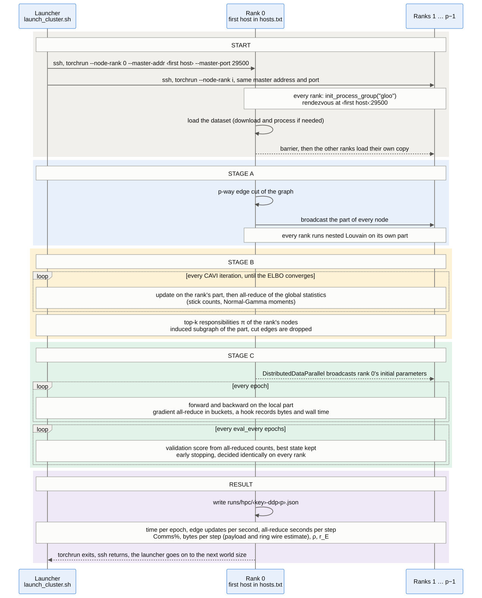

# Architecture

Block diagrams of how the code is organised and how a result comes about. They show what the repository does; what the
method is and why is in [METHOD.md](METHOD.md), and how to run the experiments is in [REPRODUCING.md](REPRODUCING.md).

The diagrams are Mermaid sources in [`diagrams/`](diagrams/) rendered to SVG, so GitHub displays them without a
service. To change one, edit its `.mmd` file and run `python scripts/make_diagrams.py` (it needs `mmdc`, the Mermaid
command-line tool, and renders only what changed); `--check` fails if a source and its SVG disagree, and a test runs
the same check. A figure of module names is also a claim about the code, so one of them is tested against it (section 3).

## 1. The pipeline

Stages A and B need only NumPy, SciPy and NetworkX; PyTorch enters at the batches, where the per-part tensors are
built. Stage A cuts the graph into *p* parts and finds nested Louvain communities inside each part. Stage B fits the
nested hierarchical Dirichlet process by coordinate ascent (the ELBO is exact and monotone) and keeps the *k* largest
responsibilities of every node. The result of both stages is cached in `stages_<dataset>_<hash>.npz`, so every depth
and every model that shares a graph and a partition shares one inference. The gate and the operator are computed from
the cached responsibilities when the batches are built, not cached. A run ends in one JSON record with the metrics,
the timings, the diagnostics on the logits and the environment.

## 2. One n-HDP layer

A layer has three levels that read the same input states. The node level is attention over the graph's edges whose
scores are multiplied by the gate, so an edge between nodes with disjoint responsibilities carries (almost) no message.
The community level pools the nodes into super-nodes with the soft assignment (Eq. 16), lets the super-nodes attend to
one another on the super-node graph and sends the result back. The global level reads out the super-nodes with a
mass-weighted softmax (Eq. 17) and broadcasts it. The three are summed, normalised, passed through ELU and dropout and
combined with the input by the residual mode: `res` adds it, `initial` mixes in the encoder's output, `none` leaves
it out. `docs/METHOD.md` has the equations.

## 3. Modules and their layers

A layer imports only from the layers below it, and the boxes of a row do not import from one another. Blue modules
import without PyTorch, green ones need it. This is what lets the stages, the sweeps, the report and the artifacts run
on a machine without PyTorch, and what keeps the tests that need it separate. It is enforced rather than assumed:
`tests/test_architecture.py` parses this diagram and fails if a module is missing from it or appears twice, if a module
imports from a higher layer or across a row, if a module's colour disagrees with whether it imports PyTorch at module
level, or if a blue module cannot be imported in a process that has no PyTorch.

## 4. From a configuration to a table

Each table and figure of the article is one TOML file in `configs/`. The sweep runner expands it into runs, skips those
that already have a result or a recorded failure, runs the rest one process each, and writes one record per run. A run
that exceeds the memory budget or the time limit leaves a failure record with the reason instead of a value, and the
tables list it. `scripts/make_tables.py` builds the article's layout from the records. The runs come from a laptop,
from the `reproduce` workflow on GitHub's runners (which merges its tables into `results/<sweep>`), or, for the
multi-node tables, from the cluster.

## 5. The cluster

The article's platform is 14 worker nodes behind a 24-port Gigabit Ethernet switch and a master and launcher host.
The first diagram carries only what the article states; the second is one run of `nhdp_gnn.distributed`: rank 0 loads
the data and broadcasts the edge cut, every rank runs the stages on its own part, the global statistics and the
gradients are all-reduced, and rank 0 writes the result. [CLUSTER.md](CLUSTER.md) has the details, an example
addressing plan (marked as an example, because the article gives no addresses) and the tool that records the real
inventory of the machines.

## 6. How the repository is checked

Read each row from left to right: the check, the GitHub Actions workflow that runs it, and what a run leaves behind.

- **Unit tests** (`pytest`) check the parts one by one against what their tests expect. Locally the tests that need
  PyTorch are skipped and reported as skipped, which is not a pass; the `tests` workflow installs PyTorch, so it is
  where they run.
- **The smoke check** (`scripts/smoke.py`, [configs/smoke.toml](../configs/smoke.toml)) runs the whole pipeline end to
  end on a 270-node planted graph. At the `numpy` level it needs no PyTorch and takes seconds; at the `full` level
  it also runs the trainer, every model through the sweep runner, the worker pool, resuming, the table builder, a
  two-part run, two-rank DDP training and the time-limit failure record, and a missing PyTorch fails it. The numeric
  floors in its checks are sanity bounds well below what the graph gives, so they catch a broken pipeline and say
  nothing about accuracy; the measured value of every check is in its report.
- **The demo** (`examples/demo.py`, [examples/README.md](../examples/README.md)) shows what each stage computes on one
  planted graph, against the known truth. The copy in `examples/output/` comes from a run of the `demo` workflow,
  never from another machine; `tests/test_committed_outputs.py` checks that it records a run of that workflow on a
  clean checkout of a commit in the history and that its tables follow from its JSON and its run records. The training
  results of the demo depend on the CPU model of the runner (see [examples/README.md](../examples/README.md)).
- **Measurement workflows** produce the article's experiments, not a check of correctness: `reproduce` runs a table's
  sweep, `determinism` asks whether a run repeats. See [REPRODUCING.md](REPRODUCING.md).

A passing smoke check or demo says that the pipeline runs and behaves as described on a synthetic graph. It is not
evidence about accuracy on real graphs; that comes from the sweeps in [results/](../results/README.md).
