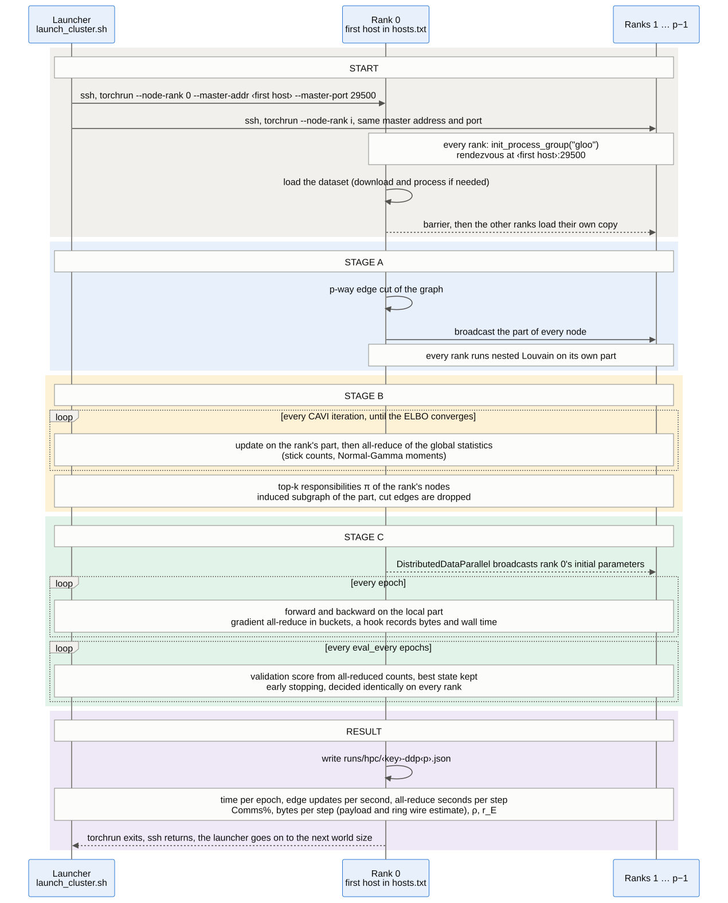

# The 14-node cluster

The distributed experiments of the article (Tables 9-12) ran on a small CPU cluster: 14 HP ProDesk desktop
machines as workers, one tower host as master and launcher, and a 24-port Gigabit Ethernet switch. This page
collects what the article says about that platform, what it leaves out, a reference setup for building a cluster
of the same shape, and the tool that records the real inventory from the real machines.

> **What is and is not known.** The article gives no HP model numbers, CPU model, memory size, host names or IP
> addresses, and nothing in this repository was measured on the original machines. Section 1 is what the article
> states. The addresses, names and configuration files of section 5 are an **example** for building a cluster of
> this shape, so that the launcher, the scripts and this page agree with one another; they are not the original
> addresses. Section 8 is the tool that replaces the example by what the machines themselves report.

## 1. What the article states

Section 10 of the article ("HPC platform and distributed pipeline for n-HDP-GNN",
[DOI 10.1007/s11227-025-08017-9](https://doi.org/10.1007/s11227-025-08017-9)) states:

| Item | Stated in the article |
|---|---|
| Worker nodes | 14 HP ProDesk desktop machines; each has a 6-thread CPU and Intel UHD Graphics 630 |
| Master and launcher | one tower host, which carries a GTX 1080 Ti (11 GB of memory) |
| Network | one 24-port Gigabit Ethernet switch (1 GbE); a flat layer-2 network with static addressing; the switch and VLAN are reserved while timed runs are made |
| Operating system | Ubuntu Server on every node, with password-less OpenSSH |
| Python environment | one Python 3.12 environment, `/opt/cluster-env`, with PyTorch (CPU), PyTorch Geometric, mpi4py, NumPy, SciPy and Louvain; the environment is copied to every node |
| Training | PyTorch DistributedDataParallel (DDP) with the gloo backend |
| Data | the OGB and Planetoid datasets are replicated on every node, to avoid contention on shared storage |
| Pipeline | a one-time edge cut into 14 parts; Louvain communities on each part; nested-HDP inference per part with only small global statistics synchronised; the workers exchange gradients; node features stay local |
| Node counts | the article calls the cluster 14-node in one place and 15-node in another, and also speaks of 14 worker nodes plus a master node; the two counts differ by the master host |

## 2. What the article does not state

None of the following is stated in the article, and none of it has been recorded in this repository yet. The
collector of section 8 records what a machine can report about itself; the rest needs someone at the hardware.

| Item | Status |
|---|---|
| HP ProDesk model numbers and generation | not stated, not recorded |
| CPU model and clock, memory, storage, network adapter of a worker | not stated, not recorded |
| Make, model, CPU and memory of the tower host; whether its GPU was used (the environment the article lists is the CPU build of PyTorch) | not stated, not recorded |
| Make and model of the switch; whether it is managed; the VLAN id; the MTU | not stated, not recorded |
| Subnet, IP addresses, gateway, host names | not stated, not recorded |
| Ubuntu release, kernel, and versions of OpenSSH, PyTorch, PyTorch Geometric, mpi4py, NumPy, SciPy (only Python 3.12 is stated) | not stated, not recorded |
| Which launcher started the processes (this repository uses `torchrun`), and what mpi4py is used for next to gloo | not stated |
| Whether the master host also ran a training rank | not stated |

When `docs/cluster/inventory.md` exists it records the first group of items for the machines it was run on, and it
supersedes this table for them.

## 3. The cluster at a glance



The labels are the article's facts of section 1, plus the rank numbers of this repository's launcher: rank *i* is
the *i*-th line of the hosts file. No address appears, because the article gives none.

## 4. How a run uses the machines



For each world size *p* in `WORLD_SIZES`, `scripts/launch_cluster.sh` opens one `ssh` per rank on the first *p*
hosts of the hosts file, and each runs `torchrun --nnodes p --nproc-per-node 1 --node-rank i --master-addr FIRST_HOST
--master-port 29500 -m nhdp_gnn.distributed --config CONFIG`. In `nhdp_gnn/distributed.py`:

* rank 0 loads the dataset first (downloading it if needed) while the other ranks wait, computes the *p*-way edge
  cut and broadcasts it; every rank then runs nested Louvain on its own part (stage A);
* every rank runs nested-HDP inference on its part and all-reduces the global sufficient statistics (stick counts
  and Normal-Gamma moments) once per iteration (stage B);
* every rank trains on its part with DDP, which averages the gradients; node features never leave their node
  (stage C);
* rank 0 writes the result file `<out_dir>/<key>-ddp<p>.json`, including the time per epoch, the all-reduce
  payload and time per step, and the cut-edge ratio rho.

## 5. A reference addressing plan (example values)



**These are example values, not the addresses of the original cluster.** One flat subnet of the private range
`192.168.0.0/16` (RFC 1918), `192.168.100.0/24`, on the switch alone. The rule is simple enough to check by eye: a
worker's address ends in `11 + rank`, and its name is `nhdp-w` followed by `rank + 1` in two digits.

| Host | Rank | Name | Address |
|---|---|---|---|
| tower (master and launcher) | none | `nhdp-master` | `192.168.100.10` |
| worker 01 | 0 | `nhdp-w01` | `192.168.100.11` |
| worker 02 | 1 | `nhdp-w02` | `192.168.100.12` |
| worker 03 | 2 | `nhdp-w03` | `192.168.100.13` |
| worker 04 | 3 | `nhdp-w04` | `192.168.100.14` |
| worker 05 | 4 | `nhdp-w05` | `192.168.100.15` |
| worker 06 | 5 | `nhdp-w06` | `192.168.100.16` |
| worker 07 | 6 | `nhdp-w07` | `192.168.100.17` |
| worker 08 | 7 | `nhdp-w08` | `192.168.100.18` |
| worker 09 | 8 | `nhdp-w09` | `192.168.100.19` |
| worker 10 | 9 | `nhdp-w10` | `192.168.100.20` |
| worker 11 | 10 | `nhdp-w11` | `192.168.100.21` |
| worker 12 | 11 | `nhdp-w12` | `192.168.100.22` |
| worker 13 | 12 | `nhdp-w13` | `192.168.100.23` |
| worker 14 | 13 | `nhdp-w14` | `192.168.100.24` |

The plan has no gateway: the nodes need no route off the switch during a timed run, and the article reserves the
switch for the run. Give the nodes a temporary uplink (or a local package mirror) only while installing software.

### Static address (netplan, one file per node)

Ubuntu Server configures the network with netplan. For worker 01 (rank 0); change the interface name (`ip -br link`
shows it) and the address on each node:

```yaml
# /etc/netplan/01-nhdp.yaml  (example; sudo chmod 600 it, then sudo netplan apply)
network:
  version: 2
  renderer: networkd
  ethernets:
    eno1:
      dhcp4: false
      addresses: [192.168.100.11/24]
      # routes: [{to: default, via: 192.168.100.1}]   # only if the network has a gateway
```

### Names

The same lines in `/etc/hosts` on the launcher and on every node (or the same records on a local DNS server):

```
192.168.100.10  nhdp-master
192.168.100.11  nhdp-w01
192.168.100.12  nhdp-w02
192.168.100.13  nhdp-w03
192.168.100.14  nhdp-w04
192.168.100.15  nhdp-w05
192.168.100.16  nhdp-w06
192.168.100.17  nhdp-w07
192.168.100.18  nhdp-w08
192.168.100.19  nhdp-w09
192.168.100.20  nhdp-w10
192.168.100.21  nhdp-w11
192.168.100.22  nhdp-w12
192.168.100.23  nhdp-w13
192.168.100.24  nhdp-w14
```

On each node, remove any line that maps the node's own name to `127.0.1.1`, and check that the name resolves to the
cluster address: `getent hosts "$(hostname)"` must print `192.168.100.1x`, not a loopback address. `sudo hostnamectl
set-hostname nhdp-w01` sets the name.

`configs/hosts.example.txt` is the matching hosts file for the launcher: one worker per line in rank order, the first
line being rank 0 and the rendezvous point. Copy it to `hosts.txt` (ignored by git) and replace the names with the
real ones.

### The interface gloo uses

gloo binds to the address that the node's own hostname resolves to. If that is a loopback address (a common default
on Debian and Ubuntu installs), the ranks cannot reach each other: gloo falls back to loopback, logs a warning that
names `GLOO_SOCKET_IFNAME`, and the run hangs or fails at the first collective. Either fix the name resolution as
above, or name the interface, which `scripts/launch_cluster.sh` passes on to every rank:

```bash
GLOO_SOCKET_IFNAME=eno1 HOSTFILE=hosts.txt ./scripts/launch_cluster.sh configs/cluster_check.toml
```

### Firewall and ssh

Ubuntu Server ships with the firewall off. If you turned `ufw` on, allow the cluster subnet, because the rendezvous
uses port 29500 on the first host and gloo opens further ports between every pair of ranks:
`sudo ufw allow from 192.168.100.0/24`.

The launcher needs password-less ssh from the launcher to every host. On the launcher,
`~/.ssh/config`:

```
Host nhdp-*
    User nhdp
    IdentityFile ~/.ssh/id_ed25519
    BatchMode yes
    ConnectTimeout 15
    ServerAliveInterval 30
```

and `for h in $(grep -v '^#' hosts.txt); do ssh-copy-id "$h"; done` once (the user name is an example).

## 6. Preparing the nodes

The same on every worker, as the article describes it (section 1):

1. Ubuntu Server, one user for the runs, a static address and a name as in section 5.
2. One Python 3.12 environment at `/opt/cluster-env`: the CPU build of PyTorch (2.3 or later, from
   `pip install torch --index-url https://download.pytorch.org/whl/cpu`), then `pip install -e '.[gnn,ogb,fast]'` for
   PyTorch Geometric (2.6 or later), OGB, and `pymetis` and `igraph` for METIS partitions and fast Louvain (see
   `docs/REPRODUCING.md`, "Hardware notes"). This repository does not use mpi4py, which the article lists in its
   environment. Build the environment once and copy it to every node at the same path, for example
   `rsync -a /opt/cluster-env/ nhdp-w02:/opt/cluster-env/`; a virtual environment keeps working at the same absolute
   path on machines with the same operating system and CPU architecture.
3. A copy of this repository at the same path on every node (`REPO` for the launcher, default: the directory the
   launcher is run from).
4. The datasets on every node: run `python -c "from nhdp_gnn.data import load_dataset; load_dataset('ogbn-products')"`
   on each node once, or copy `data/` with rsync. rank 0 loads first and the others wait, so a shared download is
   never needed, and the article replicates them to avoid shared-storage contention.

## 7. Checking the cluster before the long runs

1. Names and ssh: `for h in $(grep -v '^#' hosts.txt); do ssh -o BatchMode=yes "$h" 'getent hosts "$(hostname)"'; done`
   prints one non-loopback address per node without asking for a password.
2. Links: with `iperf3` (`sudo apt install iperf3`) run `iperf3 -s` on one node and `iperf3 -c NAME` from another. A
   healthy 1 GbE link gives about 0.94 Gbit/s of TCP throughput (1448 payload bytes in every 1538 on the wire); much
   less means a 100 Mbit/s link, a bad cable or a duplex mismatch. The collector of section 8 reports each node's
   negotiated speed and flags nodes that differ.
3. The collector: `python scripts/cluster_inventory.py --hosts hosts.txt --master-local --repo REPO` (section 8)
   reports whether all hosts are on one subnet, whether two hosts share an address, whether any node's name resolves
   to loopback, and what differs between the nodes (CPU, memory, kernel, Python and package versions, the commit of
   the repository, the CPU frequency governor, the negotiated link speed).
4. The distributed path itself, without a dataset or a download:

   ```bash
   HOSTFILE=hosts.txt WORLD_SIZES="2 14" ./scripts/launch_cluster.sh configs/cluster_check.toml
   python -m nhdp_gnn.report runs/cluster-check --scaling
   ```

   `configs/cluster_check.toml` is a small planted graph that every rank generates itself (800 nodes, 10 epochs). It
   shows that ssh, the environment, the rendezvous, gloo and the all-reduces work between the machines at the
   world sizes you ask for. It says nothing about accuracy or speed.

## 8. Recording the real inventory

Run the collector, `scripts/cluster_inventory.py`, on the launcher host (with the hosts file of the cluster) and commit what it writes:

```bash
python scripts/cluster_inventory.py --hosts hosts.txt --master-local --repo /srv/n-HDP-GNN \
    --addresses subnet --out docs/cluster/inventory
```

Every host is asked, over ssh, to run a short Python 3 program that reads `/proc`, `/sys`, `lscpu`, `ip`, `lspci`,
the package metadata of the shared environment and `git`. It records: make, model and BIOS of the machine (DMI), CPU
model, sockets, cores, threads and clock, the frequency governor, turbo and SMT state, memory visible to the OS, the
graphics adapter, each network interface (state, MTU, negotiated speed, driver, IPv4 addresses), the default route,
what the node's own hostname resolves to, the operating system and kernel, the Python and package versions, and the
commit of the repository. It does not collect MAC addresses, serial numbers or UUIDs. With `--master-local` the
machine it runs on is the master and is read directly; `--master NAME` reads it over ssh instead. A host that does not
answer is listed with the error, and the exit status is 1.

The output is `docs/cluster/inventory.md` (tables and the checks of section 7) and `docs/cluster/inventory.json`
(everything, for scripts). `--addresses` decides how much of the network addressing is written: `full` (default),
`subnet` (only the networks, not the hosts' addresses) or `none`. Publish only private addresses (`10.0.0.0/8`,
`172.16.0.0/12`, `192.168.0.0/16`); a public address of a host that accepts ssh is an invitation, and host names can
identify an institution. If you do not want to run the collector, paste the table of machines and addresses into an
issue and it can be added by hand, labelled as typed in.

## 9. Reproducing Tables 9-12

The distributed tables have not been reproduced in this repository: they need the cluster. With the cluster ready
(sections 5 to 7):

```bash
HOSTFILE=hosts.txt ./scripts/launch_cluster.sh configs/hpc_products.toml                  # world sizes 1 2 4 8 14
HOSTFILE=hosts.txt ./scripts/launch_cluster.sh configs/hpc_products.toml --depth 30
HOSTFILE=hosts.txt ./scripts/launch_cluster.sh configs/hpc_proteins.toml
python -m nhdp_gnn.report runs/hpc --scaling
```

Run them with the switch to yourself, as the article does, and record the inventory first, so that every timing in
the results can be tied to the machines that produced it. The launcher stops at once if a rank fails; the other
ranks are left to finish or to time out on their own, so look for stray `nhdp_gnn.distributed` processes on the nodes
before starting again. Extra arguments are joined with spaces and parsed again by the shell on the node.

## 10. The diagrams

The diagrams are Mermaid sources in `docs/diagrams/` rendered to SVG; `python scripts/make_diagrams.py` renders
what changed and `--check` fails if a source and its SVG disagree (a test does the same). `cluster.mmd` carries only
the facts of section 1. `addressing.mmd` carries the example values of section 5 and says so in its first box.
