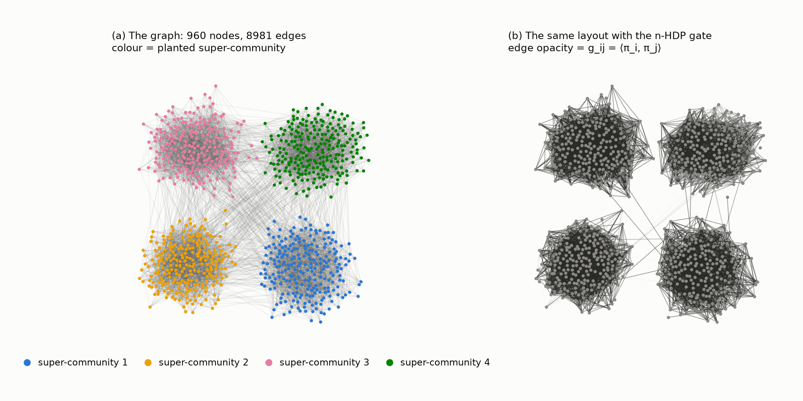
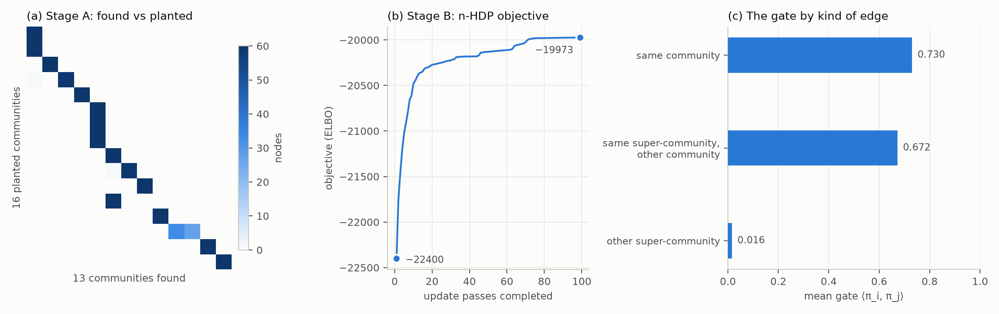
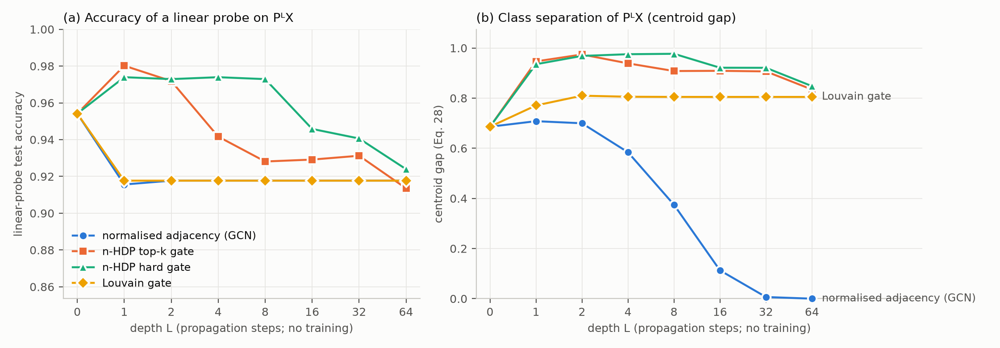
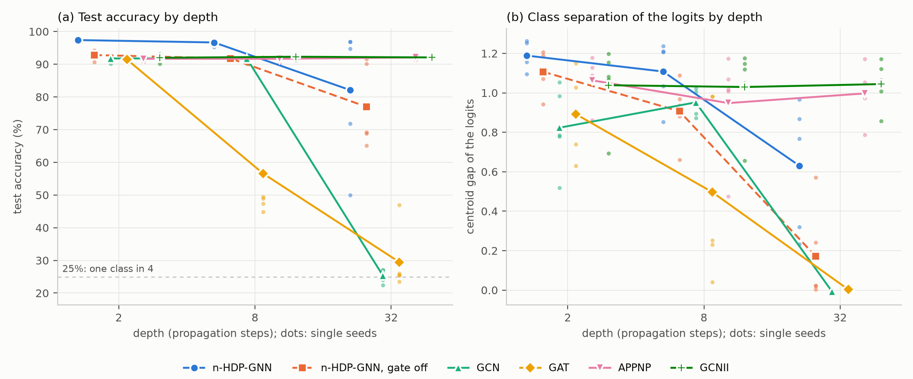

# n-HDP-GNN demo

Generated by `python examples/demo.py --train yes --jobs 4 --seeds 5 --out examples/output --work demo_work` on 2026-11-18 at code commit c9540feb54fa, CPU AMD EPYC 9V74 80-Core Processor, Python 3.12.16, numpy 2.5.5, torch 2.15.0+cpu; run time 9.9 min. It ran in the GitHub Actions workflow `demo` ([run 44330815122](https://github.com/VKHS/n-HDP-GNN/actions/runs/44330815122)).

One planted synthetic graph, built without a download, so that every stage can be compared with the truth. It shows what each stage computes and how the pieces behave. It is a demonstration of the mechanics, not evidence about accuracy on real graphs: [results/README.md](../../results/README.md) and [artifacts/README.md](../../artifacts/README.md) have those. Every number below was computed by the script that generated this file. Sections 1 to 4 are computed without PyTorch. Training (section 5) can give different values on another CPU model, in unstable cells (deep models) by many points ([examples/README.md](../README.md), how to read it).

## 1. The graph

|  |  |
|---|---|
| nodes / undirected edges | 960 / 8981 (average degree 18.7) |
| planted hierarchy | 4 super-communities of 4 communities of 60 nodes |
| edges inside a community / inside a super-community | 63.7% / 92.3% |
| classes | 4; a node keeps its super-community's class with probability 0.9, otherwise it takes another class |
| edge homophily (same class at both ends) | 0.766 |
| features | 16-dimensional Gaussian around a class mean (signal-to-noise 1.0) |
| diameter / connected components | 5 / 1 |
| share of node pairs at least 8 hops apart | 0.0% |

MADGap (Chen et al.) compares node pairs at least 8 hops apart with neighbours up to 3 hops away. The diameter here is 5, so no pair is 8 hops apart, the remote set is empty and MADGap is not defined as intended; it is not reported in this demo (the centroid gap of Eq. 28 is). The [artifacts](../../artifacts/README.md) report MADGap on the real graphs.

## 2. Stage A: nested Louvain communities

Louvain found 3 levels: 13 communities (planted: 16) in 4 super-communities (planted: 4), in 0.08 s.

| agreement with the planted structure | NMI | ARI |
|---|---|---|
| communities | 0.915 | 0.718 |
| super-communities | 1.000 | 1.000 |

Purity of the super-communities against the class labels: 0.903. The heat map in panel (a) of the next figure shows which found community holds which planted one.

## 3. Stage B: nested HDP

The n-HDP coordinate ascent ran 100 passes (stopped at the iteration limit); the objective is evaluated after every pass but the last, 99 values, from -22399.8 to -19972.7; its smallest step was 0.209 (monotone). 13 atoms carry mass and 13 are used after the top-k truncation; the largest responsibility averages 0.956. Stage B took 0.33 s.

| hard n-HDP assignment against the planted structure | NMI | ARI |
|---|---|---|
| super-communities | 0.749 | 0.736 |
| class labels | 0.772 |  |

Purity of the hard assignment against the class labels: 0.951.

The gate of an edge is g_ij = ⟨π_i, π_j⟩, the overlap of the two nodes' responsibilities:

| kind of edge | edges | mean gate |
|---|---|---|
| same community | 5717 | 0.730 |
| same super-community, other community | 2571 | 0.672 |
| other super-community | 693 | 0.016 |

Averaged over all edges the gate is 0.658. The super-node graph built from the responsibilities has 0.9% of the graph's directed edges (edge reduction r_E = 0.991).
The gate is close to zero on the edges between super-communities and large on the edges inside them, whichever community of the super-community they join.

## 4. Depth without training

The depth study applies each operator P to the input features L times and measures PᴸX: a logistic-regression probe on 20 labels per class (test accuracy, mean over 5 label draws, C chosen on validation) and the centroid gap of Eq. 28 (class separation; 0 means the class centroids coincide). No GNN is trained. The normalised adjacency is GCN's operator; the gated operators are P_ij = Â_ij g_ij with the n-HDP top-k responsibilities, their hard assignment, and the coarsest Louvain community.

**Linear-probe test accuracy of PᴸX (%), mean ± 95% interval over 5 label draws**

| operator \ depth L | 0 | 1 | 2 | 4 | 8 | 16 | 32 | 64 |
|---|---|---|---|---|---|---|---|---|
| normalised adjacency (GCN) | 95.4 ± 2.3 | 91.6 ± 1.4 | 91.8 ± 1.2 | 91.8 ± 1.2 | 91.8 ± 1.2 | 91.8 ± 1.2 | 91.8 ± 1.2 | 91.8 ± 1.2 |
| n-HDP top-k gate | 95.4 ± 2.3 | 98.0 ± 0.5 | 97.2 ± 1.2 | 94.2 ± 1.5 | 92.8 ± 1.5 | 92.9 ± 1.3 | 93.1 ± 1.7 | 91.4 ± 2.1 |
| n-HDP hard gate | 95.4 ± 2.3 | 97.4 ± 1.0 | 97.3 ± 1.2 | 97.4 ± 1.4 | 97.3 ± 1.4 | 94.6 ± 1.7 | 94.1 ± 2.4 | 92.4 ± 2.8 |
| Louvain gate | 95.4 ± 2.3 | 91.8 ± 1.2 | 91.8 ± 1.2 | 91.8 ± 1.2 | 91.8 ± 1.2 | 91.8 ± 1.2 | 91.8 ± 1.2 | 91.8 ± 1.2 |

**Centroid gap of PᴸX**

| operator \ depth L | 0 | 1 | 2 | 4 | 8 | 16 | 32 | 64 |
|---|---|---|---|---|---|---|---|---|
| normalised adjacency (GCN) | 0.686 | 0.708 | 0.700 | 0.584 | 0.375 | 0.113 | 0.007 | 0.000 |
| n-HDP top-k gate | 0.686 | 0.947 | 0.974 | 0.939 | 0.908 | 0.909 | 0.907 | 0.834 |
| n-HDP hard gate | 0.686 | 0.935 | 0.968 | 0.975 | 0.977 | 0.921 | 0.921 | 0.848 |
| Louvain gate | 0.686 | 0.771 | 0.810 | 0.806 | 0.805 | 0.805 | 0.805 | 0.805 |

At depth 64 the centroid gap of the normalised adjacency is 0.000: the class centroids of the unit-length rows of PᴸX differ by a cosine distance of 2.2e-05. The probe reaches 91.8% there. A probe can read a difference only down to some size: with the deviations of the rows from their mean shrunk by a factor of 1000 it reaches 23.4%; predicting one class for every node gives 23.4% to 26.0%, depending on the class. A probe accuracy that stays flat with depth therefore does not by itself show that propagation has kept the classes apart; the centroid gap measures how far apart they are.

In panel (a) of the next figure the normalised adjacency and the Louvain gate give the same accuracy from depth 2 on, so one line hides the other.

In the limit of infinite depth, propagation stays inside the connected components of the gate's support, so the purity of those components bounds a classifier's accuracy (docs/METHOD.md, Proposition):

| gate | connected components | purity bound |
|---|---|---|
| no_gate | 1 | 0.259 |
| nhdp_topk | 1 | 0.259 |
| nhdp_hard | 73 | 0.977 |
| louvain | 4 | 0.903 |

The soft top-k gate is positive, if tiny, on some edges between clusters, so its support is as connected as the ungated graph and gives the same bound; the hard n-HDP assignment and the Louvain gate cut.

## 5. Depth with training

Six models trained on this graph with the same settings, at depths 2, 8, 32, 5 seeds each (the seed changes the split, the initialisation and the stage-B initialisation). Semi-supervised: 4 classes x 20 labelled nodes; validation and test nodes are those of the 60/20/20 split of the same seed. Hidden size 64, 4 heads, learning rate 0.005, weight decay 0.0005, at most 200 epochs, early stopping on validation accuracy with patience 50, the selected state evaluated once on the test nodes. These are generic settings, the same for every model; none was tuned, and none is the article's. "Gate off" is the same n-HDP-GNN with every edge gate set to 1 (the community and global attention still use the responsibilities).

**Test accuracy (%), mean ± 95% interval**

| model \ depth | 2 | 8 | 32 |
|---|---|---|---|
| n-HDP-GNN | 97.4 ± 0.6 (n=5) | 96.7 ± 1.0 (n=5) | 82.1 ± 25.8 (n=5) |
| n-HDP-GNN, gate off | 92.8 ± 1.7 (n=5) | 91.8 ± 0.8 (n=5) | 77.0 ± 15.9 (n=5) |
| GCN | 91.8 ± 1.2 (n=5) | 91.8 ± 1.2 (n=5) | 25.3 ± 2.6 (n=5) |
| GAT | 91.5 ± 1.6 (n=5) | 56.6 ± 24.8 (n=5) | 29.5 ± 12.1 (n=5) |
| APPNP | 91.7 ± 0.8 (n=5) | 91.7 ± 1.2 (n=5) | 92.1 ± 0.7 (n=5) |
| GCNII | 92.0 ± 1.5 (n=5) | 92.3 ± 1.0 (n=5) | 92.1 ± 0.3 (n=5) |

**Centroid gap of the logits (Eq. 28), mean ± 95% interval**

| model \ depth | 2 | 8 | 32 |
|---|---|---|---|
| n-HDP-GNN | 1.19 ± 0.09 (n=5) | 1.11 ± 0.20 (n=5) | 0.63 ± 0.41 (n=5) |
| n-HDP-GNN, gate off | 1.11 ± 0.13 (n=5) | 0.91 ± 0.19 (n=5) | 0.17 ± 0.30 (n=5) |
| GCN | 0.82 ± 0.26 (n=5) | 0.95 ± 0.08 (n=5) | -0.01 ± 0.01 (n=5) |
| GAT | 0.89 ± 0.26 (n=5) | 0.50 ± 0.56 (n=5) | 0.00 ± 0.00 (n=5) |
| APPNP | 1.06 ± 0.15 (n=5) | 0.95 ± 0.34 (n=5) | 1.00 ± 0.17 (n=5) |
| GCNII | 1.04 ± 0.25 (n=5) | 1.03 ± 0.27 (n=5) | 1.04 ± 0.15 (n=5) |

**k-means NMI of the logits, mean ± 95% interval**

| model \ depth | 2 | 8 | 32 |
|---|---|---|---|
| n-HDP-GNN | 0.88 ± 0.01 (n=5) | 0.88 ± 0.01 (n=5) | 0.87 ± 0.01 (n=5) |
| n-HDP-GNN, gate off | 0.74 ± 0.06 (n=5) | 0.70 ± 0.01 (n=5) | 0.70 ± 0.00 (n=5) |
| GCN | 0.70 ± 0.00 (n=5) | 0.70 ± 0.00 (n=5) | 0.00 ± 0.00 (n=5) |
| GAT | 0.70 ± 0.00 (n=5) | 0.69 ± 0.00 (n=5) | 0.65 ± 0.10 (n=5) |
| APPNP | 0.70 ± 0.01 (n=5) | 0.70 ± 0.01 (n=5) | 0.70 ± 0.01 (n=5) |
| GCNII | 0.70 ± 0.01 (n=5) | 0.70 ± 0.00 (n=5) | 0.70 ± 0.01 (n=5) |

**Median best epoch / median epochs run** (a best epoch near 1 means the validation metric never improved on the first epochs: the model did not train under these settings)

| model \ depth | 2 | 8 | 32 |
|---|---|---|---|
| n-HDP-GNN | 36 / 86 | 32 / 82 | 38 / 88 |
| n-HDP-GNN, gate off | 32 / 82 | 18 / 68 | 68 / 118 |
| GCN | 5 / 55 | 6 / 56 | 39 / 89 |
| GAT | 12 / 62 | 14 / 64 | 1 / 51 |
| APPNP | 11 / 61 | 11 / 61 | 13 / 63 |
| GCNII | 7 / 57 | 10 / 60 | 13 / 63 |

With 5 seeds the intervals are wide and no significance test is reported; the smallest possible two-sided Wilcoxon p-value would be 0.062.

90 of 90 runs completed, 0 failed, 0 have no record.

In the figure a marker is the mean over the seeds and each small dot is one seed; the 95% intervals are in the tables above. The dashed line in panel (a) is the accuracy of choosing one class at random.

## Provenance

`python examples/demo.py --train yes --jobs 4 --seeds 5 --out examples/output --work demo_work`; code commit c9540feb54fa; Linux-7.0.0-1019-azure-x86_64-with-glibc2.43; 4 CPUs; scipy 1.18.1, scikit-learn 1.9.1, networkx 3.7, torch_geometric 2.8.1. `demo.json` holds every number above, the graph's parameters and the training configuration; `runs.jsonl.gz` the result record of every training run.
